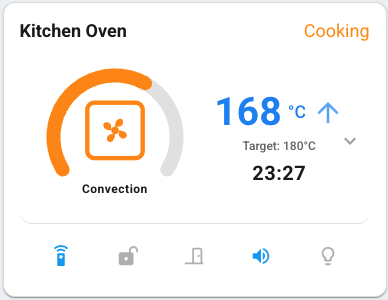
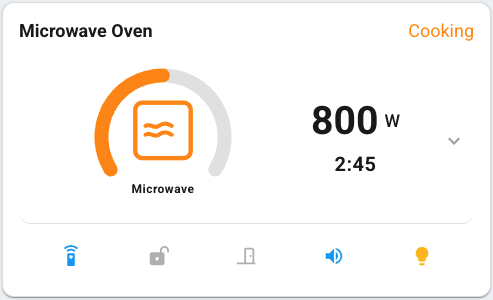
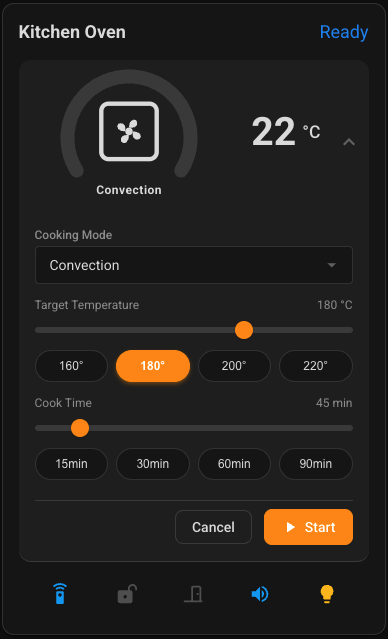
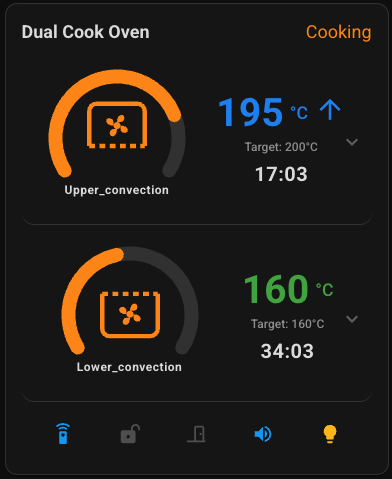

# Samsung Oven Card for HACS

A custom Lovelace card for Home Assistant designed specifically for Samsung smart ovens integrated via [LocalThings](https://github.com/LocalThings) (local SmartThings integration).

It provides an appliance-focused interface featuring real-time cooking mode graphics, an animated circular progress ring, remaining time countdown, dynamic temperature/wattage displays, expandable cooking controls, and quick-toggle indicators.

[](https://github.com/tomhaskell/ha-samsung-oven-card/releases)
[](https://github.com/tomhaskell/ha-samsung-oven-card/actions/workflows/validate.yml)
[](https://github.com/hacs/default)
[](./LICENSE)

---

## Previews

|                   Active Cooking (Single Cavity)                    |                         Microwave Mode                          |
| :-----------------------------------------------------------------: | :-------------------------------------------------------------: |
|  |  |

|                     Expanded Controls & Staged Settings                     |              Dual-Zone Split Mode (Upper & Lower)              |
| :-------------------------------------------------------------------------: | :------------------------------------------------------------: |
|  |  |

---

## Features

- **Dynamic Cooking Mode Icon**: Displays custom SVG oven icons representing the current cooking mode (Convection, Grill, Microwave, Air Fryer, Defrost, Steam Clean, and more).
- **Circular Progress Gauge**: An animated gauge ring tracking cooking progress percentage, leaving an opening at the bottom for status.
- **Live Remaining Time Countdown**: Displays the time remaining computed from `estimated_finish` and counts down every second in real time across each cavity.
- **Temperature & Wattage Monitoring**:
  - Large current temperature readout with the target temperature shown beneath.
  - **Dynamic status colors**: **Blue** when warming up, **Red** when cooling down, and **Green** when within target temperature.
  - **Animated trend arrows**: Upward pulsing arrow when heating up; downward pulsing arrow when cooling down to reach target.
  - **Microwave mode detection**: Automatically switches from temperature to current microwave wattage (e.g. `900 W`).
- **Expandable Cooking Controls**: Click any cavity panel to expand staged cooking settings:
  - Cooking mode dropdown selector.
  - Target temperature slider + quick preset buttons (`160°`, `180°`, `200°`, `220°`).
  - Cook time slider + quick preset buttons (`15m`, `30m`, `60m`, `90m`).
  - **Start**, **Stop**, and **Cancel** buttons with remote control safety checks.
- **Dual-Zone Split Cavity Support**: Automatically discovers subdevices and independently displays both the Upper and Lower cavities in real time when split mode is active.
- **Bottom Status & Control Bar**:
  - Status indicators for **Smart Control**, **Child Lock**, and **Door** (open/closed).
  - One-click toggles for **Oven Light (Lamp)** and **Sound**.
- **Visual Card Editor**: Graphical configuration dialog that automatically discovers and filters LocalThings Samsung oven devices.

---

## Installation

### Via HACS (Recommended)

#### Option A: Adding as a Custom Repository

Until this card is included in the default HACS store, you can add it directly to HACS as a custom repository:

1. In Home Assistant, open **HACS**.
2. Click the **three dots menu** (top right corner) and select **Custom repositories**.
3. In the **Repository** field, paste:
   ```text
   https://github.com/tomhaskell/ha-samsung-oven-card
   ```
4. In the **Type** dropdown, select **Dashboard** (or **Lovelace** / **Plugin** depending on your HACS version).
5. Click **Add**.
6. Find **Samsung Oven Card** in HACS, click **Download**, and confirm.
7. Reload your browser or dashboard when prompted.

---

### Manual Installation

1. Download `samsung-oven-card.js` from the latest [GitHub Releases](https://github.com/tomhaskell/ha-samsung-oven-card/releases) (or build it locally using `npm run build`).

2. Copy `samsung-oven-card.js` into your Home Assistant configuration directory under:

   ```text
   config/www/samsung-oven-card.js
   ```

3. Add the card as a Dashboard resource:
   - In Home Assistant, navigate to **Settings > Dashboards > Three Dots (top right) > Resources**.
   - Click **Add Resource**.
   - Set **URL** to:
     ```text
     /local/samsung-oven-card.js
     ```
   - Set **Resource Type** to **JavaScript Module**.
   - Click **Create**.

4. Hard-refresh your browser (`Ctrl + Shift + R` or `Cmd + Shift + R`) to load the new resource.

---

## Configuration

### Via the Visual Editor

1. Open your dashboard and click **Edit Dashboard** (pencil icon).
2. Click **Add Card** (+ button) and search for **Samsung Oven Card**.
3. Select your oven from the **Oven Device** dropdown (the editor automatically discovers LocalThings devices with "oven" in their name).
4. (Optional) Provide a custom **Card Title**, and **Temperature** & **Cook Time** shortcuts
5. Click **Save**.

### Via YAML

You can also configure the card manually in your Lovelace YAML:

```yaml
type: custom:samsung-oven-card
device_id: <your-oven-device-id>
title: Kitchen Oven # optional
standard_temperatures: [160, 180, 200, 220] # optional presets
standard_times: [15, 30, 60, 90] # optional presets (minutes)
```

#### Configuration Options

| Option                  | Type           | Required | Default              | Description                                                                          |
| ----------------------- | -------------- | -------- | -------------------- | ------------------------------------------------------------------------------------ |
| `type`                  | string         | **Yes**  | —                    | `custom:samsung-oven-card`                                                           |
| `device_id`             | string         | **Yes**  | —                    | The Home Assistant device ID for your Samsung oven from the LocalThings integration. |
| `title`                 | string         | No       | Device Name          | Custom title displayed in the card header.                                           |
| `standard_temperatures` | list or string | No       | `160, 180, 200, 220` | Preset temperature buttons displayed in the expanded oven controls.                  |
| `standard_times`        | list or string | No       | `15, 30, 60, 90`     | Preset cook time buttons (minutes) displayed in the expanded oven controls.          |

> [!TIP]
> You can find your `device_id` by navigating to **Settings > Devices & Services > Devices**, selecting your oven, and copying the ID from the URL (or by using the visual card editor dropdown).

---

## Development

Refer to [CONTRIBUTING.md](./CONTRIBUTING.md) for more details.
